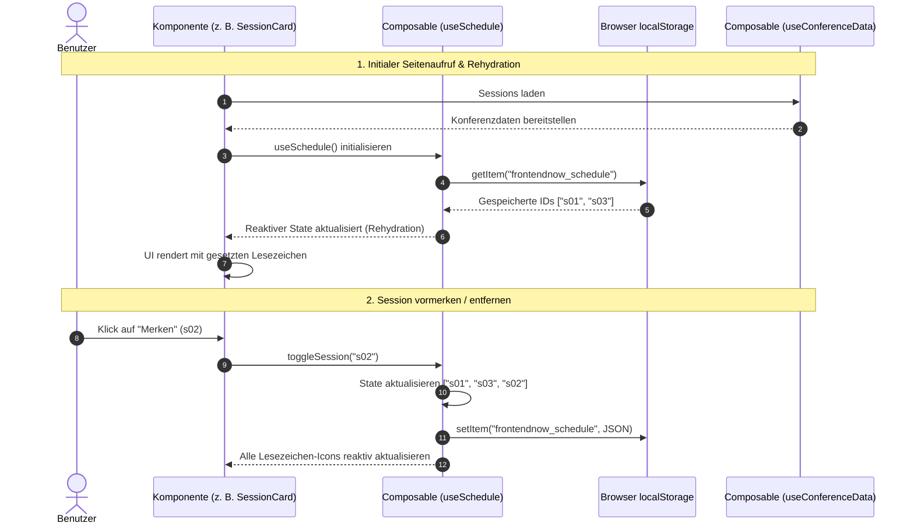

# C: State-Management-Konzept: Konferenzdaten & „Mein Programm“

## 1. Datenbasis und geteilter Zustand (`conference-data.json`)

Die Anwendung nutzt die Datei `conference-data.json` als statische, schreibgeschützte Datenquelle für Konferenzdaten (Sessions, Speaker, Räume und Tracks). Da die Plattform ohne eigenes Backend auskommt, werden diese Daten über ein zentrales Composable `useConferenceData()` bereitgestellt.

Die Daten werden beim Aufruf einmalig importiert und über ein Nuxt-`useState` bzw. ein geteiltes Vue-`readonly(ref())` gekapselt. Komponenten wie die Session-Übersicht, Filter und Speaker-Detailseiten greifen lesend auf dieselbe reaktive Datenquelle zu, wodurch redundante Importe und unnötiger Speicherverbrauch vermieden werden.

## 2. Personalisierter State & Persistenz

### Datenstruktur: Nur IDs statt ganzer Objekte

Für die Personalisierungsfunktion speichern wir im Browser-Speicher (`localStorage`) **ausschließlich ein Array von Session-IDs** (z. B. `["s01", "s05", "s12"]`).

- **Datenkonsistenz:** Ändern sich Details im statischen Konferenzdatensatz (z. B. Raumwechsel oder Zeitverschiebung), bleiben die gemerkten Einträge im Zeitplan stets aktuell, da keine veralteten Session-Objekte im Browser-Speicher liegen.
- **Speichereffizienz:** Das Array benötigt nur minimale Speicherkapazität im `localStorage`. Die vollen Session-Objekte werden zur Anzeige zur Laufzeit reaktiv via `computed` aus den Basisdaten abgeleitet.

### Kapselung im Composable `useSchedule()`

Die Logik zur Verwaltung des Zeitplans wird in `useSchedule()` ausgelagert:

- Es hält ein reaktives Set bzw. Array der gemerkten IDs (`savedSessionIds = ref<string[]>([])`).
- Es stellt Hilfsfunktionen wie `toggleSession(id)` und `isBookmarked(id)` bereit.
- Jede Änderung am Zustand schreibt den aktualisierten Stand sofort als serialisiertes JSON in den `localStorage` (Schlüssel: `frontendnow_schedule`).

## 3. Reaktivität & Rehydration beim Neuladen

Da Nuxt Rendering auf Server- und Client-Ebene unterstützt, ist der Browser-Storage beim initialen Server-Render noch nicht verfügbar. Ein unbedachter Zugriff würde zu Hydration-Fehlern führen.

Die Rehydration erfolgt daher clientseitig:

1. Beim ersten Laden startet `savedSessionIds` als leeres Array.
2. Im Client-Lifecycle (`onMounted` bzw. abgesichert per `process.client`) liest `useSchedule()` den Schlüssel aus dem `localStorage`.
3. Der Inhalt wird geparst und in den reaktiven State übernommen.
4. Durch die Reaktivität von Vue aktualisieren sich alle aktiven Komponenten (z. B. Lesezeichen-Icons, Zeitplan-Ansicht) ohne manuelles Neuladen der Seite.

---

## 4. Datenfluss- und Sequenzdiagramm

