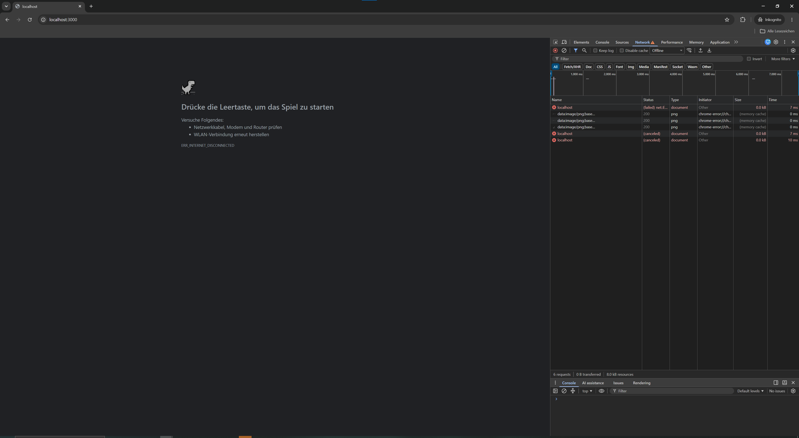
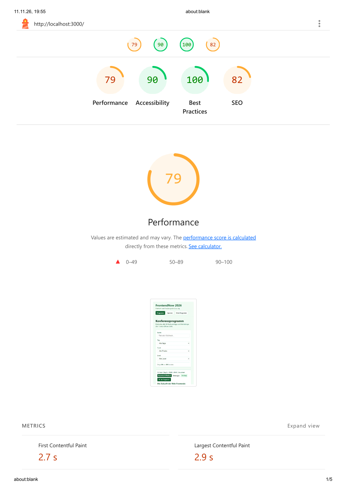

# Verifikations-Nachweis: PWA- & Offline-Funktionalität

## 1. Testumgebung & Methodik
Die Verifikation der Offline-Fähigkeiten und Service-Worker-Implementierung erfolgte in einer Produktionsumgebung (`npm run build` gefolgt von `npm run preview`) unter Google Chrome DevTools. Zur Validierung wurden zwei Prüfverfahren kombiniert:
1. **Network-Tab Offline-Simulation:** Gezielte Trennung der Netzwerkverbindung zur Überprüfung der Caching-Regeln (Cache-First für App-Shell/Assets, Stale-While-Revalidate für Konferenzdaten) und Rehydration von „Mein Programm“ (Szenarien i und ii).
2. **DevTools PWA-Prüfung & Lighthouse-Audit:** Analyse der PWA-Kriterien im Application-Tab (Installierbarkeit, Manifest-Validität, Service-Worker-Registrierung) sowie Lighthouse-Audit der Basismetriken (Best Practices: 100 %, Accessibility: 90 %, SEO: 82 %).

---

## 2. Testergebnisse & Belege

### A. Chrome DevTools Network-Analyse (Szenario i & ii & iii)

* *Beobachtung:* Nach Trennung der Verbindung werden sämtliche Ressourcen (`/`, `/schedule`, JS-Chunks, CSS-Tokens und `conference-data.json`) transparent aus dem Service Worker Cache bezogen. Die Spalte *Size* weist den Ursprung `(ServiceWorker)` aus. Die Ladezeit liegt unter 40 ms.

* *Beobachtung:* Im frischen Inkognito-Fenster ohne vorigen Service-Worker-Installationslauf schlägt der initiale Dokument-Request erwartungsgemäß mit `ERR_INTERNET_DISCONNECTED` fehl.
* 
### B. PWA- & Lighthouse-Validierung

* *Ergebnis:* Die Anwendung erfüllt alle Kernkriterien:
  * Installierbarkeit und Manifest im Application-Tab verifiziert (Name, Start-URL `/`, Theme-Color `#166534` und Icons in 192px sowie 512px).
  * Service Worker erfolgreich registriert (`activated and is running`) und beantwortet Offline-Anfragen mit Status 200.
  * Lighthouse-Audit belegt Best Practices mit 100 %, Barrierefreiheit mit 90 % und SEO mit 82 %.

---

## 3. Einordnung & Verbleibende Lücken
Die Tests beweisen, dass die Kernfunktionalitäten der Plattform für den Konferenzeinsatz vollständig offlinefähig sind. Die Navigation zwischen Übersicht und „Mein Programm“ sowie das Filtern funktionieren ohne Internetverbindung nahtlos.

*Bestehende Lücken:*
1. **Späte SWR-Aktualisierung:** Werden Programmdaten im Hintergrund via Stale-While-Revalidate aktualisiert, sieht der Nutzer die Änderungen erst beim folgenden Reload, da kein UI-Banner („Neue Daten verfügbar – Jetzt neu laden“) angebunden ist.
2. **Dynamische Session-Detailseiten:** Routen unter `/sessions/[id]` werden zwar im Client-Routing aus den gecachten JSON-Daten gespeist; ein direkter Hard-Reload im Offline-Modus auf einer Deep-Link-Detailseite hängt jedoch von den Pre-Rendering-Einstellungen ab.